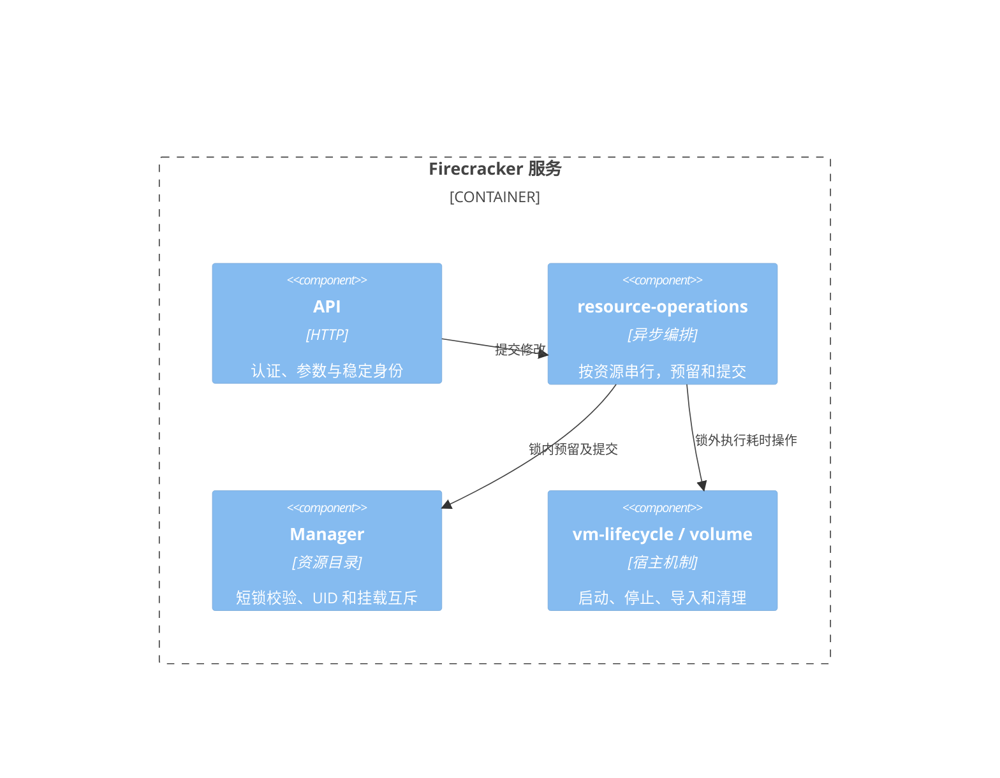

# Firecracker isolation server

独立的 Linux / Rust 服务，为 Codex、Claude Code、DSH、OpenCode 等原生运行时提供 microVM 隔离机制。它不实现模型协议、不自动批准工具调用；运行时由可信 guest 镜像或管理员安装的通用服务包提供。现有 cells 的 harness driver 不受修改。

也可保持现有 Debian 镜像不变，通过通用服务包、SSH 和宿主 systemd 投递配置、启动/监督服务、发布端口；支持按 VM ID 保留完整可写根盘。安装、开机恢复、停止与显式销毁见 [通用服务与持久根盘](doc/services.md)。

## 自动准备运行环境

统一入口为 `./vmm.sh`；不带参数或使用 `help`/`--help` 时显示帮助。`./vmm.sh build` 默认只构建 release 管理程序、Firecracker/jailer 和 virtiofsd，不构建或重新压缩 kernel/image。显式使用 `./vmm.sh build --os` 才处理 OS 制品。

`setup`、`network`、`shared-root` 同样接受 `--os`：默认复用 `BUILD_DIR/images` 中已有的 kernel、rootfs 和 initrd，缺少时提示显式构建。首次安装、新 SSH 公钥需要进入镜像或需要更新 guest 时使用 `--os`。默认 `build` 可以在没有 OS 文件时完成，生成程序制品和校验清单；之后完整安装前仍需准备 OS 文件。已有 OS 文件会纳入校验清单，但不会重新生成或压缩。

Linux x86_64 的 Debian/Ubuntu 宿主（Python 3.11+），以普通用户运行，脚本只在安装依赖、导出文件系统和部署时调用 sudo。默认直接使用相邻的 `../fc-hp`，即当前的 `~/share/prj/x1/tools/fc-hp`，不会重新 clone 或应用补丁。

```bash
cd ~/share/prj/x1/tools/fc-server
./vmm.sh setup --os
./vmm.sh network --os
./vmm.sh start demo project
./vmm.sh ssh demo
```

`setup` 依次安装宿主依赖、构建制品、安装到系统目录并检查运行条件；会启动构建所需的 Docker，但不会自动启动或重启 Firecracker 服务。`network` 在没有活动 VM 时准备独立网卡、DHCP/DNS、IPv4 NAT 和 SSH，并部署镜像、启用及重启管理服务；它拒绝中断已有 VM。宿主必须已提供 KVM、cgroup v2 和 mount/PID/network namespace 能力。首次 OS 构建会联网下载 Rust 依赖、内核源码和 Debian 容器，建议预留约 20 GiB 空间，默认编译并行度为 8。需要无网 VM 时跳过 `network`，用 `sudo systemctl enable --now firecracker-server` 启动管理服务。

也可分步执行：

```bash
./vmm.sh deps       # apt 依赖及缺失的 rustup
./vmm.sh build      # release 构建程序；kernel/image 保持不变
./vmm.sh build --os # 同时构建 kernel/image 并生成 OS 压缩包
./vmm.sh package    # 重新生成 kernel/rootfs 的 zstd 发布包及校验文件
./vmm.sh smoke      # 临时 VM 真实 KVM 块卷 + virtio-fs 验收，需要免交互 sudo
./vmm.sh install    # 安装；运行中的服务须先显式停止
./vmm.sh check      # 检查已安装路径、配置、密钥、KVM 和 namespace
./vmm.sh network    # 为已安装环境配置网络和 SSH，需要当前没有 VM
./vmm.sh start demo project  # 新建 VM，直通已授权的 project
./vmm.sh list       # 列出当前 VM、服务状态、IP 与端口；可加 --all / --json
./vmm.sh ip demo    # 查询 guest 私有 IPv4 地址
./vmm.sh reboot demo # 重启指定 VM；持久根盘保留，临时根盘重新创建
./vmm.sh publish demo 18080:8080/tcp --listen 0.0.0.0  # 发布到宿主所有 IPv4 地址
./vmm.sh ports demo # 查询当前 VM 的 TCP/UDP 映射
./vmm.sh unpublish demo 18080/tcp # 删除一条映射
./vmm.sh ssh demo   # 登录交互式终端；也可追加远程命令
./vmm.sh stop demo  # 删除 VM；临时根盘修改随之丢弃
```

### 更新受管服务：以 cell-x1 为例

`cell-x1` 由 `firecracker-workload@cell-x1.service` 监督。更新它的服务包时，停止这个实例的监督服务即可，不需要停止全局的 `firecracker-server.service`，也不会停止其他 VM。

```bash
./vmm.sh service status cell-x1
./vmm.sh service stop cell-x1
./vmm.sh service install \
  /etc/mindos-firecracker/service-sources/cells-x1/service.toml \
  --identity /home/li/.ssh/mindos-firecracker
./vmm.sh service start cell-x1
./vmm.sh service status cell-x1
```

其中 `cell-x1` 是 VM ID，`cells-x1` 是该示例的服务包 ID。`service stop` 会停止并禁用该实例的监督 unit；如果需要开机自动恢复，将上面的启动命令替换为 `./vmm.sh service up cell-x1 cells-x1 --enable`。只需重启已安装的受管服务时，使用 `./vmm.sh reboot cell-x1`。

不要把普通 `./vmm.sh stop cell-x1` / `./vmm.sh start cell-x1` 用作受管服务的更新流程：前者仅停止 VM，仍在运行的监督服务会恢复它；后者使用默认 `debian13` profile 及命令行目录创建实例，与服务包的 profile、挂载或代理配置不同，会返回 `API_ID_CONFLICT`。先查看 `service status`，无需删除持久根盘来解除此类冲突。

如果目的是把当前 `cell-x1` 的 Git/Node 升级到新镜像版本，请直接按后文[当前 cell-x1 的完整系统升级流程](#当前-cell-x1-的完整系统升级流程)操作；不要只重复上述服务包更新命令。

Git 提交身份、GitHub 密钥和用户 rootfs 的初始化统一使用私有 YAML：`./vmm.sh environment check|up|apply FILE.yaml`。首次创建自动初始化，重启保留用户修改，显式 `apply` 才更新已有配置。示例见 [environment.yaml](examples/environment.yaml)，字段与生命周期见[用户环境](doc/services.md#用一个-yaml-管理用户环境)。

`service install` 只安装服务包，不更新 Debian 系统包、Node 或镜像。`fd`（`fd-find`）、`rg`（`ripgrep`）、`vim` 等工具由 `guest/Dockerfile` 的 APT 安装步骤提供。镜像配方变化需通过 `./vmm.sh build --os` 构建、部署；已有持久根盘仍固定使用原基础镜像，采用新系统版本需要单独升级该 VM，或迁移到新根盘，停止再启动不会自动升级。详见[持久根盘与服务管理](doc/services.md)。

`build --os` 的完整构建包含服务 release、fork 指定 toolchain 的 musl Firecracker/jailer、Rust virtiofsd、内建 virtio-fs/vsock/ext4/i8042 的 Linux 6.18.54 内核，以及默认 **2048 MiB（2 GiB）** 的 Debian testing 根盘。默认 `GUEST_FLAVOR=harness` 预装 Codex、Claude Code、DSH；`GUEST_FLAVOR=base` 只构建精简基础系统。内核源码由 kernel.org 下载，校验脚本固定的 SHA-256；制品哈希写入 `build/SHA256SUMS`。virtiofsd 从校验 SHA-256 的固定 1.14.0 源码构建，并应用 `patches/virtiofsd-statx.patch`，支持 FUSE 7.39 `STATX`，透传宿主实际提供的创建时间；包含 UID/GID 映射、文件句柄校验和只读模式转发。构建按补丁/脚本及二进制摘要复用缓存，不自动选用未修补的系统 daemon。内核配置以 fork 自带的 6.18 microVM 配置为基础，显式启用直通与正常关闭所需选项，并关闭 `CONFIG_FUSE_DAX`：该分支没有 DAX shared-memory region，开启时 guest virtio-fs 探测会失败。

运行镜像基于 `debian:testing-slim`，从 testing 安装 Git 等系统包，以支持协调工作区使用的相对 worktree。现有 `debian13` profile、脚本和制品文件名保留为兼容标识，不表示镜像仍使用 Debian 13 软件源。Node 构建阶段继续使用已锁定的版本镜像，最终运行系统为 testing。

运行镜像保留 Bash、Git、Python、bubblewrap、systemd、udev、网络基础组件及非 root vsock 服务。默认还安装 less、Vim、fd（Debian 的 fd-find，提供 fd 命令）、ripgrep、procps（top/ps/free）、iproute2（ip/ss）、curl、jq、file、tree、lsof、ping、dig、unzip、rsync、psmisc（pstree/killall）。基础版和 harness 版都包含这些工具，导出镜像前以 agent 用户检查命令是否存在。man/info、语言翻译和普通文档在构建时裁剪，保留版权文件与 C.UTF-8；禁用 APT 更新、备份、fstrim 等定时任务、getty 及等待联网服务，journald 使用有界内存日志。systemd 继续负责服务隔离、挂载和正常关机。

工具清单变更在下一次 `./vmm.sh build --os` 构建镜像时生效；普通 `build` 和 `install-server` 不更新 OS。已创建的持久根盘继续固定使用原基础镜像，不能通过替换全局 lower 给旧 upper 升级；应单独维护该 VM，或新建根盘后迁移数据。

运行版通过 Docker BuildKit 多阶段构建使用 Node 26.13.0，最终只复制 Node 和生产依赖，不保留 npm、开发头文件或编译工具；npm 缓存保存在 BuildKit cache mount 中，不进入运行镜像。`guest/runtimes/package.json` 固定 Codex 0.164.0、Claude Code 2.1.209、DSH 0.2.0-rc.2，`package-lock.json` 锁定依赖树。DSH 需要新版 Node，不能直接使用 Debian 13 的 Node 20。升级工具时修改这两个文件并重新构建，禁止在每次启动时下载工具。

```bash
# 可选：源码位置、已有内核/daemon、APT 镜像及并行度。
FIRECRACKER_SOURCE=../fc-hp JOBS=4 ./vmm.sh build
KERNEL_IMAGE=/absolute/path/vmlinux VIRTIOFSD=/absolute/path/virtiofsd ./vmm.sh build --os
KERNEL_MIRROR=https://mirrors.tuna.tsinghua.edu.cn/kernel/v6.x ./vmm.sh build --os
GUEST_FLAVOR=base BUILD_DIR="$PWD/build/base" ./vmm.sh build --os
DEBIAN_MIRROR=http://mirrors.ustc.edu.cn/debian \
DEBIAN_SECURITY_MIRROR=http://mirrors.ustc.edu.cn/debian-security ./vmm.sh build --os
NPM_REGISTRY=https://registry.npmmirror.com ./vmm.sh build --os
# 显式更新根盘，成功后替换 build/images/debian13.ext4；再执行 install 部署。
REBUILD_IMAGE=1 IMAGE_SIZE_MIB=8192 ./vmm.sh build --os
```

仅在显式指定 `--os` 时处理 OS 构建：重复构建复用编译缓存；guest 配方、依赖锁、镜像类型、容量或构建参数变化时自动重建 ext4，旧版无输入记录的 4 GiB 镜像也会重建。输入相同则复用，可用 `REBUILD_IMAGE=1` 强制刷新基础镜像/系统包。`KERNEL_IMAGE` 由管理员保证兼容，真实启动可用 `smoke` 检验。构建和安装通过 `BUILD_DIR` 内的锁串行；自定义 `BUILD_DIR` 后，后续命令须沿用相同值。

产物包括 `build/images/vmlinux`、`debian13.ext4` 及各自的 `.zst` 压缩包。`debian13.ext4.json` 记录容量、文件系统已用空间、宿主实际占用、Docker 镜像 ID 和非 root 离线版本探测；`.inputs.json` 用于缓存判断。压缩包经解压校验并纳入 `SHA256SUMS`，适合后续通过 LFS 或其他制品服务分发；构建不会自动上传。解压根盘可使用 `zstd -d --sparse debian13.ext4.zst -o debian13.ext4`。部署和创建 VM 都优先尝试 reflink，并保留稀疏文件，避免把空闲块全部写入宿主磁盘。

2 GiB 是根盘容量，并非下载体积。三个工具和完整 DSH 依赖单独占据较大空间，精简基础版与运行版的大小不可直接比较。`smoke` 分别记录创建到 VMM 启动、创建到 guest 命令就绪的耗时，以及 guest 内运行时版本探测耗时；它不包含认证或真实模型请求延迟。

脚本回归验证：`python3 scripts/test-build-environment.py`；语法检查：`bash -n vmm.sh scripts/build-debian13.sh`。这些检查不需要 root；真实 VM 验收使用上面的 `smoke`。

`smoke` 会启动独立的管理服务实例，运行前需要没有业务 VM 并停止已部署的管理服务；全局宿主锁禁止同时运行两个管理实例。已部署服务的在线网络验收使用后面的 `smoke-network.py`，不需要停止管理服务。

安装位置为 `/usr/local/bin/firecracker-server`、`/usr/local/libexec/fc-hp/`、`/var/lib/mindos-images/`、`/var/lib/mindos-firecracker/`、`/etc/mindos-firecracker/` 和 systemd unit。首次安装生成 0600 的配置和随机 API key，后续安装保留它们。默认授权 `/srv/harness/project` 直通，Codex/Claude/DSH 的配置和 session 使用各自的持久块卷；新建目录归 guest 的 1000:1000 所有，可在配置中改为实际授权目录。未执行 `network` 时默认无网卡。

## 多 VM 共享基础镜像的物理内存

`rootfs_mode = "shared"` 通过 **virtio-pmem + ext4 DAX + OverlayFS** 启动。所有 VM 的 `base.ext4` 是同一个宿主 inode 的硬链接，以 `MAP_SHARED/PROT_READ` 映射并设置 KVM 只读内存槽。guest 将基础层挂为 `ro,noload,dax=always`，把各自的私有 ext4 盘作为 OverlayFS upper/work。现有 virtio-fs 项目目录可以同时使用，无需修改其 daemon 或开启 FUSE_DAX。

程序和库对未修改文件的 mmap 直接使用这些共享物理页；每台 VM 的内核、进程堆、栈、I/O 缓冲和私有修改仍分别占用内存。普通 `read()` 的用户缓冲也属于各自进程。OverlayFS 首次修改基础文件按文件执行 copy-up；它不是逐块磁盘差分。程序的私有可写 mmap 则由 guest 内核执行页级 COW。

新安装的 virtio-fs 示例配置已启用共享模式。已有安装保持原配置，可在没有活动 VM 时执行：

```bash
./vmm.sh shared-root
./vmm.sh start demo project
./vmm.sh ssh demo
```

该命令构建并部署镜像、initramfs 和服务，备份配置为 `/etc/mindos-firecracker/config.before-shared-root.toml`，将内置 `debian13` profile 切换到共享模式并启动服务。SSH 和网络槽位配置保留。直接配置时，在 profile 中加入：

```toml
rootfs_mode = "shared"
initrd = "/var/lib/mindos-images/debian13.ext4.initrd"
upper_size_mib = 2048
```

共享基础镜像必须由 root 拥有且权限为 `0444`，并与 `state_dir` 位于同一文件系统；部署器按此准备。每个 VM 的 upper 默认容量 2 GiB，按实际写入占用宿主空间；停止后清理，持久数据仍放目录绑定/卷。省略 `rootfs_mode` 时继续使用旧的私有根盘副本模式。宿主 cgroup 的共享文件缓存可能记在首次读入它的 VM 上，因此共享模式的 `memory.max` 额外预留一个基础镜像大小，容量不表示已占用内存。

服务支持 `max_vms` 1..128；100 个 VM 需要相应数量的网络槽位、CPU 和私有 RAM。共享只读文件页会引入跨 VM 缓存侧信道，应在互信程度相容的 VM 间启用。`./vmm.sh smoke` 默认包含两个真实 VM 的共享页验收：guest pagemap 验证 Node mmap 位于 PMEM 范围，宿主 pagemap 对比实际 PFN，并验证页级私有 mmap COW、文件 copy-up 隔离、基础层写保护、项目直通和重建清理。

设置 `FC_SHARED_TEST_VMS=100 ./vmm.sh smoke` 可扩大最后一项验收，使用每 VM 1 vCPU / 256 MiB 的临时无网 profile，需要宿主有足够可用内存；预留约 15 分钟。已完成 100 VM 实测，结果见 [VALIDATION.md](VALIDATION.md)。该测试验证共享映射和隔离，没有运行 100 个并发 LLM 会话。

## 统一更新基础镜像

修改基础镜像可以让之后创建新根盘的 VM 使用新的系统文件、软件和默认配置。已有持久根盘的 VM 即使停止后重新启动，仍使用原根盘和原基础镜像。某个运行中 VM 内的根盘修改只写入它自己的 upper，不会更新其他 VM 或基础镜像。当前不支持根盘热更新。

更新有三层，必须分别核对：

| 操作 | 更新位置 | 会升级已有 cell-x1 的 Git/Node 吗？ |
| --- | --- | --- |
| `./vmm.sh build --os` | `build/images/` 中的构建制品 | 不会，还没有部署 |
| `./vmm.sh install` | `/var/lib/mindos-images/` 中的全局制品 | 不会，已有持久根盘保留原版本 |
| 升级旧 VM 内的软件，或新建根盘并迁移数据 | 当前 VM 的实际运行系统 | 会，以 guest 内检查结果为准 |

`./vmm.sh service install ...` 更新的是应用服务包，不属于上述系统镜像升级流程。`service start`、`service up`、`reboot` 都不会清空已有持久根盘或自动将其转换到新基础镜像。

### 部署已构建的新镜像

以下操作涉及全局管理服务，需要维护窗口。先停止所有受管 VM 的监督服务，避免监督进程在管理服务重启后恢复旧实例；普通 VM 也应停止。以仅运行 `cell-x1` 为例：

```bash
./vmm.sh service stop cell-x1
./vmm.sh list --all
sudo /usr/local/bin/firecracker-server network idle
sudo systemctl stop firecracker-server.service
./vmm.sh install
sudo systemctl start firecracker-server.service
```

`network idle` 必须成功；有其他活动 VM 时先处理它们。`install` 使用当前 `BUILD_DIR` 的已有制品，不重新构建；若尚未构建新镜像，先执行 `REBUILD_IMAGE=1 ./vmm.sh build --os`。自定义 `BUILD_DIR` 时各步必须保持一致。只更新应用服务包时无需停止全局管理服务，使用前面的 `cell-x1` 服务包更新示例。

### 当前 cell-x1 的完整系统升级流程

适用于：新 testing 镜像已构建，但 `cell-x1` 仍显示 Git 2.47.x / Node 24，且需要保留 VM ID、配置和会话。下列命令在宿主的 `tools/fc-server` 目录、同一终端中按顺序执行；任何一步失败都停止，不进入删除根盘步骤。先结束当前 Cell 中正在执行的业务任务。示例假定只有 `cell-x1` 在运行；有其他 VM 时也必须先停止其监督服务及 VM。

**1. 确认新镜像已构建，创建私有备份目录。** 当前默认 Node 应为 `v26.13.0`；若没有该构建报告或版本仍旧，先运行 `REBUILD_IMAGE=1 ./vmm.sh build --os`。自定义 `BUILD_DIR` 时，下列路径替换为相同构建目录。

```bash
python3 -c 'import json; p=json.load(open("build/images/debian13.ext4.json")); v=p["probe"]["runtimes"]["node"]["version"]; print(v); assert v == "v26.13.0", "Build the new image first"'
umask 077
cell_upgrade_backup="$HOME/.local/state/fc-server-upgrades/cell-x1-$(date -u +%Y%m%dT%H%M%SZ)"
mkdir -m 700 -p "$cell_upgrade_backup"
printf 'Backup directory: %s\n' "$cell_upgrade_backup"
```

记录该目录的实际路径，后续步骤和回滚都要用到。备份含凭据和会话，不要放进源码仓库或公开共享目录。

**2. 停止监督服务，备份并校验旧持久根盘和宿主配置。** `root` 备份包含旧 upper、旧基础镜像、内核、initrd 和 manifest，而不是只复制一个 `rootfs.ext4`。

```bash
./vmm.sh service stop cell-x1
sudo cp -a --reflink=auto /var/lib/mindos-firecracker/roots/cell-x1 "$cell_upgrade_backup/root"
sudo cp -a /etc/mindos-firecracker "$cell_upgrade_backup/host-config"
sudo cp -a /var/lib/mindos-firecracker/services/packages/cells-x1.json "$cell_upgrade_backup/service-package.json"
sudo cp -a /var/lib/mindos-firecracker/services/vms/cell-x1.json "$cell_upgrade_backup/service-binding.json"
sudo diff -qr /var/lib/mindos-firecracker/roots/cell-x1 "$cell_upgrade_backup/root"
```

`diff` 必须成功且没有差异。备份占用取决于磁盘和 reflink 支持，先保证备份盘空间充足。

**3. 导出可迁移的 agent 用户数据，再停止旧 VM。** `service setup` 只准备 VM 和服务文件，不启动 cells 应用；此时监督服务仍停止。导出整个 agent home，保留 Codex/Claude 配置、会话及放在 home 下的 cells 数据。

```bash
./vmm.sh service setup cell-x1 cells-x1
./vmm.sh ssh cell-x1 'tar -C /home/agent -czf - .' > "$cell_upgrade_backup/agent-home.tar.gz"
tar -tzf "$cell_upgrade_backup/agent-home.tar.gz" > /dev/null
./vmm.sh service stop cell-x1
```

上一步的整盘备份同时保留了 home 以外的旧数据。若曾手工在 `/etc`、其他用户目录或其他根盘路径保存业务配置，应在后续迁移中逐项恢复；不要把旧 `/usr`、`/opt`、整个 `/etc` 或旧 upper 覆盖到新系统。直通目录和额外挂载卷保留原内容，不需要复制进新根盘。

**4. 部署新镜像。** 这一段才更新宿主全局镜像，需要停止全局管理服务；仅更新应用服务包时不需要这一段。

```bash
./vmm.sh list --all
sudo /usr/local/bin/firecracker-server network idle
sudo systemctl stop firecracker-server.service
./vmm.sh install
sudo systemctl start firecracker-server.service
```

`network idle` 必须成功。此时 `cell-x1` 的监督服务应仍停止，不要提前 `service start cell-x1`，否则会再次启动旧根盘。

**5. 在备份完整且部署成功后，显式替换 cell-x1 的根盘。** `service destroy` 会删除旧根盘及 VM 到服务包的绑定；这是本流程中会删除旧系统的步骤。服务包、额外挂载卷、直通目录及上面的备份不会被删除。

```bash
test -s "$cell_upgrade_backup/agent-home.tar.gz"
tar -tzf "$cell_upgrade_backup/agent-home.tar.gz" > /dev/null
sudo test -f "$cell_upgrade_backup/root/manifest.json"
# Destructive: run only after the backup and deployment checks above succeeded.
./vmm.sh service destroy cell-x1
./vmm.sh service setup cell-x1 cells-x1
```

**6. 恢复用户数据并验证新系统。** 只恢复用户 home，保留新镜像的系统文件和运行时。

```bash
./vmm.sh ssh cell-x1 'tar -C /home/agent -xzf -' < "$cell_upgrade_backup/agent-home.tar.gz"
./vmm.sh ssh cell-x1 'cat /etc/os-release; command -v git git-lfs node fd rg vim; git --version; git lfs version; node --version'
./vmm.sh ssh cell-x1 'git -C /home/li/share/prj/x1 rev-parse --verify "HEAD^{commit}"'
```

项目路径按实际直通目录替换。Node 应为 `v26.13.0`，Git 应支持相对 worktree（至少 2.48），`fd`、`rg`、`vim` 应存在，项目 HEAD 应正常读出。若仍选中旧版 Node/Git，检查恢复的用户配置是否在 PATH 中指定了其他版本。SSH 欢迎行中的 Linux 内核版本不能证明用户态软件已升级。

**7. 启动 cells 服务，确认就绪，再恢复协调任务。** 原有服务包已安装，不需要再次 `service install`；只有修改了 `service.toml` 或包内文件才需要在监督服务停止时重新安装。

```bash
./vmm.sh service start cell-x1
./vmm.sh service status cell-x1
```

状态应为 `ready`。需要开机自动恢复时，将启动命令替换为 `./vmm.sh service up cell-x1 cells-x1 --enable`。确认服务、原配置和会话正常后，在 NestOS 对原协调任务点击“重试规划”；校验通过后继续原任务，单纯进入 Session 不会触发恢复。保留备份直到业务与会话验证完成。

**回滚到旧系统。** 新根盘出现问题且需要恢复旧系统时，先保留新根盘中新增的必要数据，然后停止并删除新根盘，从上述完整备份恢复旧根盘、服务包和绑定，再启动。此操作恢复的是旧软件版本，不会解决原来的 Git 兼容问题。

```bash
./vmm.sh service stop cell-x1
# Destructive: remove the failed replacement root, not the backup.
./vmm.sh service destroy cell-x1
sudo cp -a --reflink=auto "$cell_upgrade_backup/root" /var/lib/mindos-firecracker/roots/cell-x1
sudo cp -a "$cell_upgrade_backup/service-package.json" /var/lib/mindos-firecracker/services/packages/cells-x1.json
sudo cp -a "$cell_upgrade_backup/service-binding.json" /var/lib/mindos-firecracker/services/vms/cell-x1.json
./vmm.sh service start cell-x1
./vmm.sh service status cell-x1
```

### 修改镜像内容

需要统一分发普通文件时，可在源码中新增 `guest/rootfs/`，按 guest 内的绝对路径组织文件，例如：

```text
guest/rootfs/etc/myapp.conf
guest/rootfs/usr/local/bin/my-tool
```

首次采用此方式时，在 `guest/Dockerfile` 最后添加以下指令，将文件复制进默认的 harness 镜像；脚本文件应在源码中设置可执行权限：

```dockerfile
COPY rootfs/ /
```

安装系统包可修改 Dockerfile 的 APT 安装步骤；升级三个工具则修改 `guest/runtimes/package.json` 和 `package-lock.json`。若使用 `GUEST_FLAVOR=base`，应把覆盖文件的 COPY 放到 base 阶段末尾、`FROM base AS harness` 之前，使两个镜像类型都继承这些文件。

保存需要持久化的数据，停止现有 VM，确认没有活动 VM 后执行：

```bash
sudo /usr/local/bin/firecracker-server network idle
./vmm.sh shared-root --os
./vmm.sh start dev project
./vmm.sh ssh dev
```

`shared-root --os` 会根据 guest 文件变化自动重建根盘，部署基础镜像和 initramfs，再启动管理服务；Firecracker 和内核复用已有编译缓存。自定义过 `BUILD_DIR`、`GUEST_FLAVOR`、镜像容量、APT/npm 镜像源或 SSH 公钥时，更新时应继续传入相应环境变量。只想刷新系统包而配方未变时，可用 `REBUILD_IMAGE=1 ./vmm.sh shared-root --os` 强制重建。

部署器通过替换文件发布新镜像，不会原地改写旧 inode。新建根盘使用新版本；已存在的持久根盘固定原 `base.ext4`、内核和 initrd，不会因替换镜像路径或重启而切换版本。当前部署命令要求先停止所有 VM。停止只清理临时根盘 upper，持久根盘、持久卷和宿主直通目录按下文规则保留。基础镜像本身以 `0444` 发布，禁止在 VM 使用它期间，通过宿主挂载、debugfs 或直接写文件的方式修改这个 ext4，以免破坏 guest 文件系统和 OverlayFS 状态。

## SSH 与网络

运行 `./vmm.sh network` 后，每个 UID 槽位都有独立的 netns、TAP、DHCP/DNS 和 IPv4 出网。默认 guest 地址为 `10.203.0.2`、`10.203.1.2` 等，宿主 veth 使用 `10.204.N.0/30`；地址按 UID 槽位分配，使用 `./vmm.sh ip VM_ID` 查询实际地址。`max_vms` 个槽位自动写入各 profile 的 `network_slots`，原配置备份为 `/etc/mindos-firecracker/config.before-network.toml`。

`mindos-firecracker-network.service` 和 `mindos-firecracker-dns@N.service` 随宿主启动，管理服务在网络/DNS 就绪后启动。配置写入 `/etc/mindos-firecracker/network.json`，支持 `FC_EGRESS_INTERFACE`、逗号分隔的公共 IPv4 `FC_DNS_SERVERS`、不重叠的私有 `/16` `FC_GUEST_NETWORK` / `FC_UPLINK_NETWORK`。网络段与现有路由冲突时拒绝配置。已有不同的网络计划或自定义 `network_slots` 不会被自动覆盖。

防火墙只管理 `inet mindos_firecracker` 和 `ip mindos_firecracker_nat` 表及 `mfc-hN` 接口，不清空宿主/Docker 规则。guest 可访问公网 IPv4，阻断宿主服务、其他 VM、RFC1918、link-local/metadata 等目标；DHCP/DNS 仅在各自 TAP 上提供。默认允许宿主直连 guest SSH；LAN/公网应用入站需通过下面的 publish 命令显式开放。IPv6 出网和宿主代理未配置；已有额外防火墙若阻断转发，应由管理员按本机策略放行，脚本不绕过它。

`network` 自动生成专用 `~/.ssh/mindos-firecracker` 密钥，私钥留在宿主，只有公钥进入 guest 镜像。可通过 `SSH_PUBLIC_KEY=/path/to/key.pub` 指定其他公钥，配套客户端使用 `SSH_IDENTITY`；设 `SSH_PUBLIC_KEY=''` 构建不授权 SSH 的镜像。构建器拒绝私钥内容。guest 仅允许 `agent` 公钥登录，禁止 root/密码登录；没有授权公钥时 SSH 服务不启动。

构建时删除 SSH 主机密钥，每台 VM 首次启动单独生成 ed25519 主机密钥。客户端按 VM ID 和本次 VMM 实例标识保存 known_hosts，避免复用 IP 时混淆不同 VM。`./vmm.sh ssh demo` 会等待 SSH 启动并提供终端，登录后可运行 `codex`、`claude` 或 `dsh`；认证凭据仍通过各自配置/持久卷管理。

vsock 7000 通道继续用于脚本和程序连接，提供非 root Bash 字节流；它没有 PTY。当前服务未暴露交互式串口入口。另一台电脑访问时，先 SSH 登录宿主，再运行上述命令。

### nftables TCP/UDP 端口映射

已实现 `publish`、`unpublish` 和 `ports` 命令，通过管理 API 协调宿主 DNAT/SNAT 与对应 VM netns 的放行规则，数据转发由内核 nftables 完成，无需 SSH 隧道。先在 guest 中启动监听 guest 网卡地址或 `0.0.0.0:8080` 的应用，再执行：

```bash
# Default: only the host itself can access 127.0.0.1:18080.
./vmm.sh publish dev 18080:8080
# Publish UDP separately; TCP and UDP can use the same host port.
./vmm.sh publish dev 18080:8080/udp
./vmm.sh ports dev
curl http://127.0.0.1:18080

./vmm.sh unpublish dev 18080/tcp
./vmm.sh unpublish dev 18080/udp
# Allow clients on LAN and any other reachable host IPv4 interface.
./vmm.sh publish dev 18080:8080/tcp --listen 0.0.0.0
```

`--listen` 默认 `127.0.0.1`，可指定 `0.0.0.0` 或宿主实际拥有的 IPv4 地址。绑定 `0.0.0.0` 后，其他电脑可通过 `http://宿主IPv4:18080` 访问；是否可从公网到达还取决于宿主之外的路由/防火墙。guest 只监听 `127.0.0.1` 的服务不能通过网卡 DNAT 访问。

宿主和 guest 端口均为 1..65535，省略协议表示 TCP；当前支持 IPv4 TCP/UDP，每个 VM 最多 16 条映射。相同 VM、相同映射重复发布是幂等的；修改已有映射应先 unpublish。服务为每条映射保留绑定 socket，检测本服务以及本机应用的端口冲突，返回 `HOST_PORT_IN_USE`；使用其他 NAT 管理器时，仍需统一规划端口，第三方纯 DNAT 规则不一定有可检测的监听 socket。

映射只属于当前 VM 实例。停止、到期、guest reboot 或服务正常重启时，先撤销映射并清理对应连接跟踪，再释放 VM 槽位；即使 VM ID/IP 被复用，旧规则也不会自动作用于新 VM，需显式重新发布。服务异常退出由 systemd 的 ExecStopPost 撤销规则，启动时也会恢复/清理未完成的发布记录。崩溃后重新启动服务前，仍需按生命周期章节检查并清理已退出 VM 的遗留 jail/cgroup。运行时记录位于 `/run/mindos-firecracker-publish/ports.json`，不作为跨重启的持久端口配置。

为适配现有 netns 隔离，映射流量会 SNAT 到该槽位的宿主 veth 地址 `10.204.N.1`，guest 应用看到的是这个地址，不保留原始客户端 IP。新映射会定向清理此前访问该宿主端口产生的连接跟踪，避免旧 UDP socket 绕过新 DNAT。仅修改本服务拥有的 nftables 表/链，不清空其他软件的防火墙表；用于发布流量的 conntrack mark 前缀 `0xfc000000/0xff000000` 由本服务保留。

现有安装升级到这一版本时，先结束活动 VM，再运行 `./vmm.sh network`，以部署 helper、conntrack 依赖和新增的 nftables 链。该命令把 `port_publisher = "/usr/local/libexec/mindos-firecracker/publish-ports"` 写入部署配置；已有配置的备份为 `/etc/mindos-firecracker/config.before-publish.toml`。之后发布/撤销映射无需重启网络或 VM。

相关网络命令和配置的区别如下：

| 命令或配置 | 当前作用 |
| --- | --- |
| `./vmm.sh network` | 准备 guest 的 IPv4 出网 NAT、DHCP/DNS 和宿主 SSH 访问，不发布应用端口 |
| `./vmm.sh ip VM_ID` | 查询 guest IP，不增加端口放行规则 |
| `./vmm.sh ssh VM_ID [COMMAND...]` | SSH 登录或执行 guest 命令；其后参数为远程命令，不是 SSH 客户端选项 |
| `./vmm.sh publish VM_ID HOST:GUEST[/tcp\|udp] [--listen IPv4]` | 为当前 VM 发布一条 TCP/UDP 映射 |
| `./vmm.sh unpublish VM_ID HOST[/tcp\|udp]` | 撤销指定协议的映射并清理其 NAT 连接 |
| `./vmm.sh ports VM_ID` | 查询当前 VM 的映射 |
| profile 的 `ports = [7000]` | 授权 vsock 服务端口，不表示宿主 TCP/UDP 端口映射 |

Firecracker 自身仍只提供 virtio-net/TAP，端口发布属于本服务的网络管理层。未发布的普通应用端口继续被 netns 防火墙阻断，宿主直连 SSH TCP 22 保持可用。真实端口验收可在有两个空闲槽位时运行 `sudo python3 scripts/smoke-publish-ports "$HOME/.ssh/mindos-firecracker"`，覆盖本机与模拟外部网段的 TCP/UDP、loopback 不对外暴露、端口冲突、撤销以及同 ID/IP 重建隔离。

追加 `--crash` 可做管理服务 SIGKILL 故障注入；该模式要求没有业务 VM，会重启管理服务，仅清理本测试产生的遗留 jail/cgroup，并验证旧端口在重建后保持关闭、显式重新发布后才可访问。

部署后的网络验收：`sudo python3 scripts/smoke-network.py "$HOME/.ssh/mindos-firecracker"`。它创建两个无共享数据的临时 VM，验证公钥登录、PTY、不同主机密钥、公网 DNS/HTTPS，以及宿主/私网/跨 VM 访问被阻断，然后正常关闭测试 VM。运行网络验收时需有两个空闲槽位。

首次启动后可直接创建带直通目录的 VM：

```bash
# 在 root shell 中读入私有 key，避免把密钥写入命令历史。
sudo -i
set -a
. /etc/mindos-firecracker/environment
set +a
curl -fsS -H "Authorization: Bearer $FIRECRACKER_API_KEY" \
  -H 'Content-Type: application/json' http://127.0.0.1:8790/v1/vms \
  -d '{"id":"demo","profile":"debian13","directories":["project"]}'
# Debian 启动后执行；guest shell 为非 root 的 agent。
printf 'cat /etc/os-release; id; ls /workspace/project; exit\n' | \
  firecracker-server connect http://127.0.0.1:8790 demo 7000
curl -fsS -X DELETE -H "Authorization: Bearer $FIRECRACKER_API_KEY" \
  http://127.0.0.1:8790/v1/vms/demo
exit
```

要持久化三个工具的配置和 session，先分别用 `binding=codex/claude/dsh` 创建 volume，再在创建 VM 的 `volumes` 中传入这些 volume ID，例如 `["codex-main", "claude-main", "dsh-main"]`；它们映射到 `/home/agent/.codex`、`.claude`、`.dsh`。没有附加卷时，这些目录属于每次启动的新根盘，修改不保留。旧安装的配置会被保留，新增绑定需由管理员合并进已有配置。

## 重启与数据保留

默认 VM 的根盘修改是临时的；停止后使用相同 VM ID 再次创建，也不会恢复旧的 upper。需要保留用户目录、系统安装等完整根盘状态时，在 profile 中显式配置 `rootfs_persistent = true`，详见 [持久根盘](doc/services.md)。保存位置决定哪些内容能够保留：

| 保存位置 | VM 停止、退出后重新创建 |
| --- | --- |
| virtio-fs 直通目录，例如 `/home/li/share/prj` | 保留，修改实际写入宿主目录；在 guest 中删除也会删除宿主文件 |
| 显式创建并挂载的持久 block 卷 | 保留，重建 VM 时需在 `volumes` 中附加原卷 ID；数据不会自动写回最初的 source 目录 |
| `rootfs_persistent = true` 的根盘 | 按 VM ID 保留；共享模式同时固定原 lower 和启动制品，普通停止不删除 |
| 其他根盘位置，例如 `/etc`、未挂卷的 `/home/agent` | 不保留，私有根盘副本或 OverlayFS upper 会随 VM 清理 |

普通 SSH 或 vsock 连接断开不会停止 VM；受管服务的 SSH 连接由监督层管理，连接中断会触发服务恢复。`./vmm.sh stop VM_ID`、管理服务正常停止/重启、VM 到达 profile 的非零 `max_lifetime_secs`，都会进入实例回收流程；持久根盘和卷保留。`max_lifetime_secs = 0` 表示管理员管理生命周期。guest 内执行 `reboot` 时，当前内核参数 `reboot=k` 会让 VMM 退出；持久根盘模式支持再次创建时复用磁盘，但不是内存状态恢复。

修改管理配置并重启服务前，先用 `sudo /usr/local/bin/firecracker-server network idle` 确认没有活动 VM；有活动 VM 时先安排停止，并把需要保留的数据放入直通目录或持久卷。

## 边界与接口

服务只监听 loopback HTTP，所有接口均要求 `Authorization: Bearer <key>`；带浏览器 Origin 的请求被拒绝。远程使用 SSH 隧道或可信 TLS 网关。一个服务实例对应一个管理员信任域，API key 具有管理该实例全部 VM/卷的权限，不提供多租户身份隔离。

| 接口 | 行为 |
| --- | --- |
| `GET /v1/health` | 服务身份和版本 |
| `GET /v1/profiles` | 可用资源配置、端口及目录绑定，不返回宿主路径 |
| `POST /v1/volumes` | `{ "id": "project-main", "binding": "project" }`，把已授权目录导入 ext4 卷 |
| `GET /v1/volumes` | 持久卷及占用状态 |
| `GET /v1/volumes/:id/disk` | 流式导出未挂载的 ext4 镜像；下载期间禁止挂载或删除 |
| `DELETE /v1/volumes/:id` | 删除未挂载的持久卷 |
| `POST /v1/vms` | `{ "id": "run-1", "profile": "debian13", "volumes": ["codex-main"], "directories": ["project"] }`；两种挂载均可省略 |
| `GET /v1/vms`、`GET /v1/vms/:id` | VMM 状态、profile、卷及运行时长 |
| `DELETE /v1/vms/:id` | 关闭 guest、回收 VMM 与 jail/cgroup，保留目录卷；返回 `{id,stopped,mode}` |
| `GET /v1/vms/:id/ports` | 当前实例的端口映射，返回 `{ports:[...]}` |
| `POST /v1/vms/:id/ports` | `{ "listen":"0.0.0.0", "host_port":18080, "guest_port":8080, "protocol":"tcp" }`；listen 默认 127.0.0.1，protocol 默认 tcp |
| `DELETE /v1/vms/:id/ports/:protocol/:host_port` | 幂等撤销指定映射，返回 `{removed:true}` |
| `POST /v1/vms/:id/connect/:port` | HTTP/1.1 Upgrade `mindos-vsock`，升级为双向字节流 |

创建 VM 时，调用方不能提交宿主路径、命令、镜像路径、内存、自定义网卡或 jailer 参数；端口发布使用独立接口，只接受监听 IPv4、宿主/guest 端口和 TCP/UDP 协议。创建使用调用方稳定 ID；同 ID 同参数重复调用返回现有资源，不创建副本；同 ID 不同参数返回 409。修改任务在客户端断开后继续完成，超时后先按原 ID 查询。VM 的幂等记录仅存在于当前服务进程，不承诺跨崩溃 exactly-once。

`state=vmm-running` 只说明 Firecracker 已启动，不表示 Debian 或 harness 已就绪。`guestReady=false` 明确保留这个区别；客户端在 guest 服务启动后才能建立相应端口连接。

## 并发与资源生命周期

同 VM 或卷的修改按稳定资源 ID 串行。全局目录锁只负责校验、资源预留和提交结果；导入、启动、停止、删除和导出文件打开在锁外执行，因此慢卷导入不阻塞其他 VM 的查询或停止。启动和停止期间仍预留 UID、目录及块卷，查询返回 `starting` / `stopping`；这些状态不可建立隧道。失败停止保留 VM 所有权以供重试，失败清理保留预留以防 UID 或挂载被复用。关闭先拒绝新建，等待已预留的启动和导入，并回收 VM；中止定期回收循环不会取消已经持有 VM 的清理任务。



## Debian 13 镜像

构建需要 Docker、sudo 和 e2fsprogs。构建过程导出 Debian 13 容器用户态，使用 `mkfs.ext4 -d` 生成镜像，不把 guest 文件系统挂载到宿主内核。内核单独提供，必须支持 Firecracker virtio-blk、virtio-vsock、ext4、devtmpfs，以及 systemd 所需的 cgroups、namespaces 等功能；根盘驱动需编入内核。私有副本模式直接启动；共享模式使用构建生成的 initramfs，并额外需要内建 PMEM、FS_DAX 和 OverlayFS。virtio-fs 模式还需内建 `CONFIG_FUSE_FS`、`CONFIG_VIRTIO_FS`、`CONFIG_VIRTIO_MMIO_CMDLINE_DEVICES`，并关闭 `CONFIG_FUSE_DAX`。

```bash
bash scripts/build-debian13.sh /path/to/debian13.ext4 2048
cargo build --release --locked
sudo install -m 0755 target/release/firecracker-server /usr/local/bin/firecracker-server
sudo install -d -m 0700 /var/lib/mindos-firecracker /var/lib/mindos-images /etc/mindos-firecracker
sudo install -m 0644 /path/to/vmlinux /var/lib/mindos-images/vmlinux
sudo install -m 0600 /path/to/debian13.ext4 /var/lib/mindos-images/debian13.ext4
sudo install -m 0600 config.example.toml /etc/mindos-firecracker/config.toml
```

下载较慢时可通过 `DEBIAN_MIRROR` 和 `DEBIAN_SECURITY_MIRROR` 选择可访问的 Debian 镜像；APT 的签名验证保持启用。镜像中的 DNS 链接在容器导出后建立，避免修改 Docker 管理的 resolv.conf 挂载点。

构建临时目录默认放在 `/var/tmp`，可用 `TMPDIR` 覆盖。导出后删除 Docker 容器标记，确保 systemd 按 KVM guest 执行卸载/落盘。CtrlAltDel 使用正常 reboot 流程和 `reboot=k` 触发 Firecracker 退出；在本配置的 `acpi=off` 下，poweroff 会停在内核 halt，不能据此判定 VMM 已退出。

编辑配置中的目录 source，提前创建源目录；目录中文件 UID/GID 保留，guest 的 `agent` 为 1000:1000。权限不匹配时应在可信源中准备正确权限，而不是放宽宿主访问。构建脚本跟随 Debian 13 的更新标签，不宣称镜像位级可复现；需要固定制品时记录基础镜像 digest、包版本和产物 SHA-256。

两种镜像都提供 7000 端口的非 root Bash 字节流，用于验证和通用命令执行；`harness` 版已预装三个运行时，`base` 版不带它们。需要直接暴露原生服务协议时，将固定入口写入 `/usr/local/libexec/harness-PORT`，启用 `harness-vsock@PORT.service`，再在 profile 中授权该端口。运行时参数和凭据由可信镜像/配置卷管理，不从 VMM 管理 API 透传任意宿主执行。

例如安装 Codex 的派生镜像可使用如下固定入口：

```sh
#!/bin/sh
export CODEX_HOME=/home/agent/.codex
cd /workspace/project
exec /usr/local/bin/codex app-server
```

这是 guest 的 stdio 服务；外部 client 使用 `connect` 传输其原生 JSON-RPC。Claude Code、DSH、OpenCode 依照各自原生服务协议配置独立端口，核心服务没有按工具名称分支。当前尚未修改 cells driver 的进程启动方式；需要接入其现有项目沙箱时，应另做 launcher 适配，不能把这个通道视为已有完整 harness 会话适配器。

## 启动与目录挂载

宿主需要可访问的 `/dev/kvm`、匹配版本的静态 Firecracker/jailer、可用的 cgroup v2 memory/cpu/pids controller、bubblewrap 和 e2fsprogs。目录导入在 bubblewrap 的文件系统/网络命名空间内执行，避免源目录符号链接指向宿主其他私有目录；不能启用隔离时导入失败，不回退到宿主直接读取。

服务、配置、镜像、jailer、state_dir 及其父目录必须 root 所有且不可由 group/other 写入，路径必须是规范绝对路径且不含符号链接。`uid_base` 开始的 `max_vms` 个 UID/GID 必须专供本服务，不可用于宿主账号或其他服务。

```bash
# Generate a private >=32-character key, and provide it through the environment.
export FIRECRACKER_API_KEY='<private-random-key>'
sudo --preserve-env=FIRECRACKER_API_KEY /usr/local/bin/firecracker-server serve /etc/mindos-firecracker/config.toml
```

长期运行可使用提供的 systemd unit。将密钥放在 root:root 0600 的 `/etc/mindos-firecracker/environment`，以 `FIRECRACKER_API_KEY=...` 配置；`KillMode=control-group` 提供额外的进程回收边界。

```bash
curl -fsS -H "Authorization: Bearer $FIRECRACKER_API_KEY" \
  -H 'Content-Type: application/json' http://127.0.0.1:8790/v1/volumes \
  -d '{"id":"project-main","binding":"project"}'
curl -fsS -H "Authorization: Bearer $FIRECRACKER_API_KEY" \
  -H 'Content-Type: application/json' http://127.0.0.1:8790/v1/volumes \
  -d '{"id":"codex-main","binding":"codex"}'
curl -fsS -H "Authorization: Bearer $FIRECRACKER_API_KEY" \
  -H 'Content-Type: application/json' http://127.0.0.1:8790/v1/vms \
  -d '{"id":"run-1","profile":"debian13","volumes":["project-main","codex-main"]}'
printf 'cat /etc/os-release; id; exit\n' | firecracker-server connect http://127.0.0.1:8790 run-1 7000
curl -fsS -X DELETE -H "Authorization: Bearer $FIRECRACKER_API_KEY" \
  http://127.0.0.1:8790/v1/vms/run-1
```

`backend = "block"`（默认）采用 **virtio-blk**：第一次导入复制文件，之后直接复用同一 ext4 镜像。它不提供宿主 bind mount，也不是实时共享文件系统。运行中的卷独占挂载；只读绑定同时设置 Firecracker `is_read_only` 和 guest `ro,nodev,nosuid`。guest 的 session、配置或项目修改保留在卷中，不会自动写回原 source。rootfs 的私有副本或共享模式 upper 都随 VM 清理，需要保留的数据应放在目录卷或直通目录中。

guest/宿主同时写同一 ext4 镜像会损坏文件系统，禁止在宿主挂载正在运行的卷。导出镜像可能含 guest 控制的文件系统数据和凭据；应作为私有制品保存，不自动以 root 挂载或解包回宿主。

Firecracker 的宿主 UDS EOF 会关闭 vsock 两个方向，不能据此保留远端最后的输出。CLI 在 stdin 结束后保留连接，等待 guest 关闭；Bash 批处理应显式 `exit`，其他协议使用自身的结束消息。终止 client 进程仍会断开通道，不会自动删除 VM。

## virtio-fs 目录直通

这是已实现的实验性 Firecracker 分支能力，标准上游二进制不能使用。首版每台 VM 最多一个 virtio-fs 目录，可同时附加多个 block 卷；不支持 DAX、快照恢复、热插拔或 backend 重连。多个独立目录需要分别授权：可以把项目设为直通、配置/session 设为持久块卷，或使用管理员专门准备的单一会话目录树，不能为绕过限制而扩大到整个 HOME。

仓库包含固定基线的 [VMM 补丁](patches/fc-hp.patch) 和重建入口；无需依赖本机的外部 worktree：

```bash
bash scripts/prepare-fc-hp.sh /path/to/new-firecracker-source
cd /path/to/new-firecracker-source
cargo build --locked --release --target x86_64-unknown-linux-musl -p firecracker -p jailer
```

基线是 `edb60617c31ebd610c530f67706ec5c79d4c2725`，对应本次实现提交 `b3795fb9dfeff3dc9ab9b526f81827ab9480bd06`。依赖遵循该基线的 Rust toolchain 和 musl 构建要求；Debian 宿主若缺少 `linux/types.h`，可设置 `CFLAGS_x86_64_unknown_linux_musl="-idirafter /usr/include -idirafter /usr/include/x86_64-linux-gnu"`。使用 `build/cargo_target/x86_64-unknown-linux-musl/release/` 下的 firecracker/jailer；GNU debug 构建不能替代默认 seccomp 验收。补丁内的 `tools/virtiofs/build-kernel.sh` 可在新输出目录构建 guest 内核。

参考 [直通配置](config.virtiofs.example.toml)，安装构建产出的 Rust virtiofsd（1.14.0 + STATX 补丁，必须支持 `--readonly`，`--print-capabilities` 的 features 包含 `statx`）。宿主还需 Linux 5.14+ 的 `openat2/open_tree/move_mount/mount_setattr/cgroup.kill`、mount/PID/network namespaces 和 bubblewrap；不支持这些边界时创建失败。服务仍需要 root，daemon 对绑定内部按 guest UID/GID 操作；可写授权包含 guest 对该目录的修改能力，不是凭据保密边界。

```toml
# Global setting, before any TOML table.
virtiofsd = "/usr/local/libexec/firecracker-virtiofs/virtiofsd"

[bindings.project]
backend = "virtiofs"
source = "/srv/harness/project"
target = "/workspace/project"
read_only = false
```

将 `project` 加入 profile 的 `bindings`，然后直接创建 VM，无需创建或导入该目录的 volume：

```bash
curl -fsS -H "Authorization: Bearer $FIRECRACKER_API_KEY" \
  -H 'Content-Type: application/json' http://127.0.0.1:8790/v1/vms \
  -d '{"id":"run-live","profile":"debian13","directories":["project"]}'
```

文件仍是宿主目录里的普通文件。`cache=never` 不启用 writeback；正常文件读写无需先转换镜像或另外调用同步 API。文件系统共享不提供应用事务、双向冲突合并或断电持久性保证，运行时仍需按自己的协议 flush/fsync，session 保持单一写入方。

### 将宿主目录映射到 guest 的相同路径

例如把宿主 `/home/li/share/prj` 映射为 guest 内的 `/home/li/share/prj`。先确认没有活动 VM，再编辑部署配置：

```bash
sudo /usr/local/bin/firecracker-server network idle
sudoedit /etc/mindos-firecracker/config.toml
```

将现有 `[bindings.project]` 改为以下内容：

```toml
[bindings.project]
backend = "virtiofs"
source = "/home/li/share/prj"
target = "/home/li/share/prj"
read_only = false
```

`[profiles.debian13]` 的 `bindings` 数组中需包含 `"project"`，示例配置已包含它。宿主 source 必须存在且路径规范、不含符号链接；guest target 目前只允许位于 `/home/` 或 `/workspace/` 下。目录内 UID/GID 保持原值，guest 的 agent 为 1000:1000，需具备相应访问权限。

保存配置后重启管理服务并创建 VM：

```bash
sudo systemctl restart firecracker-server
./vmm.sh start dev project
./vmm.sh ssh dev 'cd /home/li/share/prj && pwd'
# Open an interactive shell, then cd to /home/li/share/prj inside the guest.
./vmm.sh ssh dev
```

`read_only = false` 表示 guest 的文件修改、创建和删除都会直接作用于宿主这个目录；需要只读访问时设为 `true`。当前每个 VM 最多一个 virtio-fs 直通目录，服务也会拒绝把同一宿主目录或重叠/别名目录同时导出给多个 VM，包括只读导出。因此同路径映射不代表可以给 100 个 VM 同时挂载这个项目目录；基础镜像的 PMEM 物理页共享是另一项能力。

源目录通过无符号链接的目录 FD 固定，非递归 mount clone 排除宿主子挂载；只在 supervisor 私有挂载命名空间中挂接。每台 VM 使用独立 virtiofsd、私有 socket、namespace sandbox、seccomp 和 cgroup。只读授权同时施加只读宿主挂载及 daemon `--readonly`，guest root remount 为 rw 也不能绕过。禁用 inode file handles，daemon 无 `DAC_READ_SEARCH`；导出树中的既有硬链接同样属于已授权 inode，宿主移动文件也不等于撤销 guest 已打开的句柄。

活动直通目录互斥，普通不重叠目录可并行使用。同一文件系统的不同 mount ID 保守互斥，以覆盖直接 bind 子目录形成的别名；不能据此假设所有宿主应用都受此锁约束。daemon 能访问所属 VM 的共享 RAM，应视为该 VM 的受信任组件，不跨 VM 复用。

## 网络、回收与诊断

管理服务不创建网卡或基础出网网络；端口发布规则由管理服务随 VM 生命周期更新。可用上述 `./vmm.sh network` 在部署阶段准备受限公网出网，或由管理员预先配置 TAP、netns、DHCP/DNS 和防火墙，再通过 `profile.network_slots` 指定。数组按全局 UID 槽位索引，需覆盖 `max_vms` 个槽位；不同 profile 也应为同一槽位选择相容的预置网络。每个槽位的网卡限制由对应 netns 的防火墙实施。

资源受 vCPU、guest RAM、cgroup CPU/memory/pids、连接数和最大存活时间限制。根盘和卷是固定大小；整体镜像复制仍占宿主磁盘，生产部署应另配 state_dir 的文件系统配额。服务不会禁用默认 seccomp，也不允许绕过 jailer。关闭优先发送 CtrlAltDel，Debian 将其映射到正常 reboot 并让 VMM 退出；超过期限后强制停止并记录 `GUEST_SHUTDOWN_UNCONFIRMED`，强停后不能承诺尚未落盘的数据。

关闭结果的 `mode` 明确区分 `guest-shutdown`、`forced`、`already-exited` 和 `absent`。调用方不能把强制回收成功解释为 guest 已完成落盘。x86 guest 内核需要编入 i8042/AT keyboard 支持才能响应 CtrlAltDel；缺少该支持时将触发有界强停。

特权 supervisor 独立于 jailer 的降权过程，接收服务父进程死亡信号后杀死并回收 VMM。目录 backend 使用单独的 supervisor/cgroup；镜像复制、daemon socket 等待和 VMM 启动共享启动期限。helper 退出不等于整棵进程树退出，回收还检查 `cgroup.events`，必要时 `cgroup.kill` 并等待空组。普通退出清理 jail 和 cgroup，保留卷。异常退出可能留下 jail/cgroup；下次启动拒绝接管未知进程，管理员应先确认对应 cgroup 无进程，再删除遗留 jail 和空 cgroup，不能删除 `volumes/` 来绕过检查。

stderr 提供 JSON 诊断，包含 operation_id、阶段、结果、错误分类和操作耗时，I/O 失败额外提供 errno。不会记录原生 stdio 正文、文件正文或 API key。创建失败时核对 jailer/cgroup/KVM 运行条件；HTTP 错误提供 error、stage、operationId，HTTP 200 不代表 guest 中的业务执行成功。

## 同步与验证

首次目录导入和停止后的镜像导出属于快照传递，当前不具备文件级增量同步或双向冲突合并。配置/凭据适合显式单向投递；session 应保持单一写入方，不应在原生运行时写入期间覆盖其文件。

仓库的 [cells sync](../cells/doc/sync.md) 提供版本化对象存储、条件发布和持久回执，可作为后续同步后端；它仍需要负责 guest/宿主扫描、基线和应用文件的客户端。vsock 通道可以承载该客户端协议，但 VMM 服务不会据此宣称自动完成目录同步。

```bash
cargo fmt --check
cargo clippy --all-targets -- -D warnings
cargo test --locked
```

测试覆盖认证、Origin 拒绝、策略/路径注入、目录授权/占用、只读块设备、vsock 有界握手与 stdin EOF、真实 ext4 导入/重新加载。真实 Debian/KVM 验收使用 `scripts/smoke.py SERVER KERNEL IMAGE`；直通验收使用 `scripts/smoke-virtiofs.py SERVER KERNEL IMAGE FORK_FIRECRACKER FORK_JAILER VIRTIOFSD`。脚本要求免交互 sudo，只操作临时目录，失败不跳过；直通脚本仅在一次性镜像副本注入 root 测试端口，验证 guest remount 不能突破宿主只读授权。结果和限制见 [验收记录](VALIDATION.md)。

实现依据：[Firecracker jailer](https://github.com/firecracker-microvm/firecracker/blob/main/docs/jailer.md)、[vsock 协议](https://github.com/firecracker-microvm/firecracker/blob/main/docs/vsock.md)、[生产宿主隔离要求](https://github.com/firecracker-microvm/firecracker/blob/main/docs/prod-host-setup.md)、[Debian 13](https://www.debian.org/releases/trixie/)。


目录创建时间通过 FUSE `STATX` 返回，不能用修改时间伪造。宿主文件系统不支持创建时间时，响应保留实际 mask、不给出 BTIME；支持创建时间的 ext4 等源目录可让依赖稳定目录身份的上层完成注册。已有 VM 的 daemon 和 FUSE 协议在创建时确定，安装新 daemon 后使用 `./vmm.sh reboot VM_ID` 重新协商；无需重建 kernel、Debian image 或持久化根盘。显式 `VIRTIOFSD` 覆盖也必须声明 `statx` 能力。

补丁单测（使用已构建的源码缓存）：

```bash
cargo test --locked --release --manifest-path build/cache/virtiofsd-1.14.0-statx/Cargo.toml --target-dir build/virtiofsd/target
```

真实 virtio-fs smoke 的 rw/ro 路径均校验目录、普通文件和符号链接的创建时间与宿主一致。
